# Travel Mate — Flutter Lab Experiments

This repository contains a collection of Flutter and Dart lab experiments built around a travel-themed application. Each experiment documents its **aim**, the Flutter/Dart concepts used, the expected or observed behaviour, a screenshot of the output, and a link to its source file.

The project covers Dart basics, widgets, layouts, responsive design, navigation, state management, reusable components, forms, animations, REST API integration, testing, and debugging.

---

## Experiment 1 — Dart Basics

**Aim:** Understand the Dart program entry point, variables, arithmetic operations, string interpolation, and console output.

**Explanation:** This experiment introduces the fundamentals of Dart through a simple travel-related calculation. It demonstrates how values are stored, processed, and printed to the console.

**Source code:** [exp01b_dart_program.dart](travel_mate/lib/experiments/exp01b_dart_program.dart)

---

## Experiment 2 — Flutter Widgets and Layouts

**Aim:** Build user interfaces using common Flutter widgets and arrange elements with layout widgets.

**Explanation:** The widget experiment introduces basic UI building blocks such as Text, Image, and Container. The layouts experiment demonstrates how Row, Column, and Stack arrange multiple widgets on a screen.

**Output screenshots**

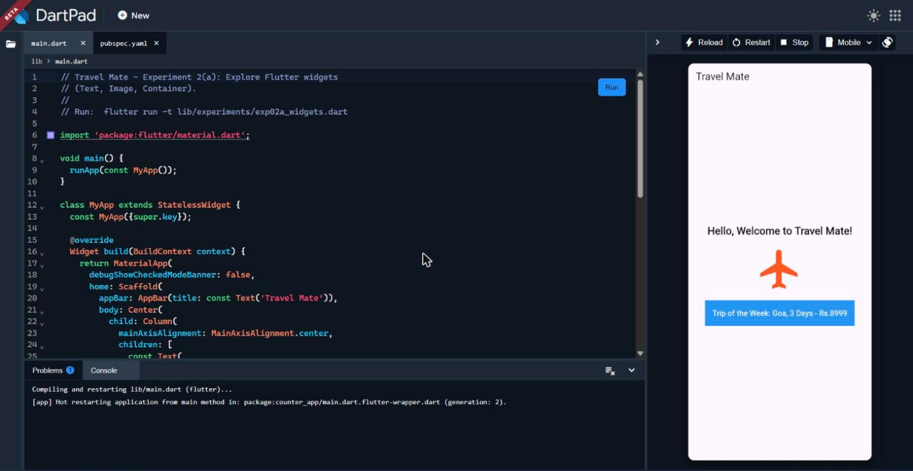

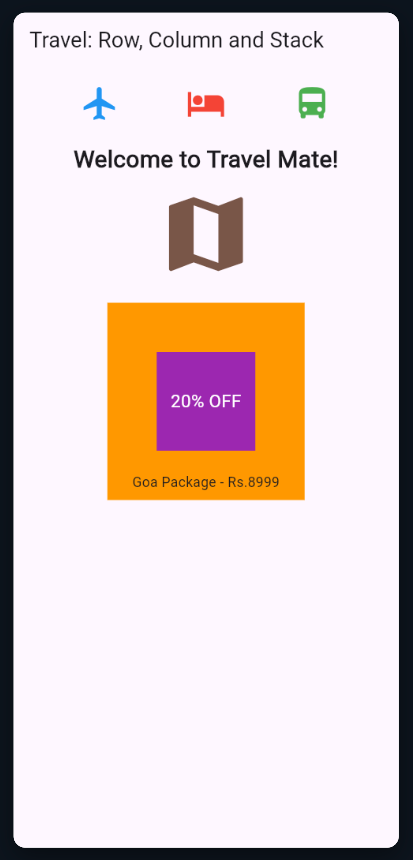

**Source code:** [exp02a_widgets.dart](travel_mate/lib/experiments/exp02a_widgets.dart) · [exp02b_layouts.dart](travel_mate/lib/experiments/exp02b_layouts.dart)

---

## Experiment 3 — Responsive UI

**Aim:** Create interfaces that adapt to different screen sizes and available layout constraints.

**Explanation:** The responsive UI experiment uses MediaQuery to read screen dimensions and adjust the interface for mobile, tablet, and desktop layouts. The breakpoint experiment uses LayoutBuilder to make layout decisions based on available width.

**Observed output:** The screenshots demonstrate responsive layouts and breakpoint behaviour across mobile, tablet, and desktop screen sizes.

**Output screenshots**

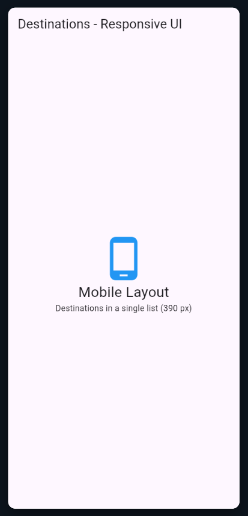

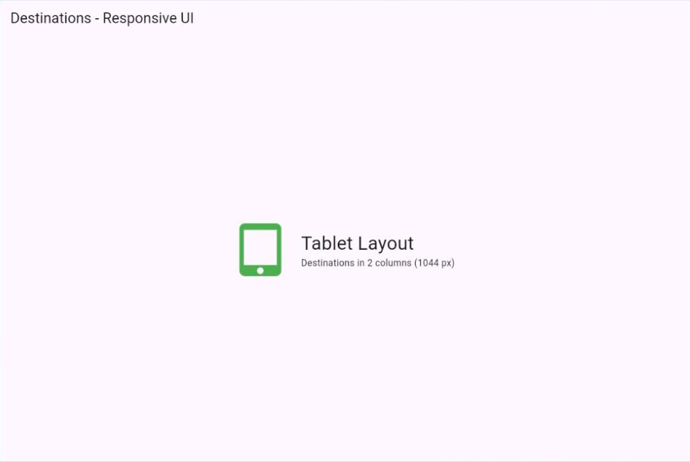

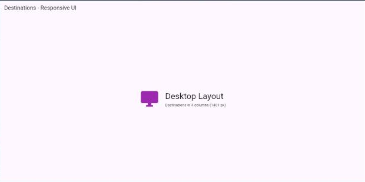

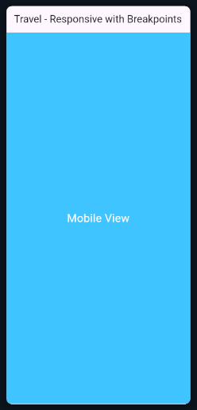

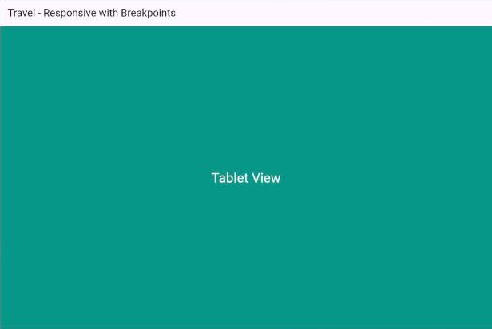

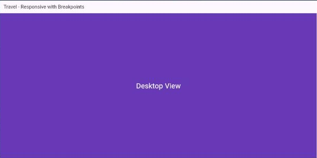

**Source code:** [exp03a_responsive_ui.dart](travel_mate/lib/experiments/exp03a_responsive_ui.dart) · [exp03b_breakpoints.dart](travel_mate/lib/experiments/exp03b_breakpoints.dart)

---

## Experiment 4 — Navigation and Named Routes

**Aim:** Navigate between multiple screens using Flutter's navigation system.

**Explanation:** The navigation experiment demonstrates moving between screens with Navigator.push() and returning with Navigator.pop(). The named-routes experiment demonstrates registering route names and navigating to screens using those names. The booking flow shows a travel booking interaction and its confirmation state.

**Output screenshots**

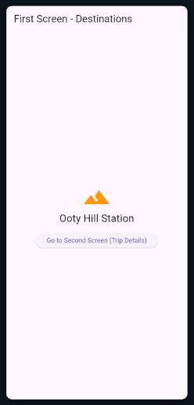

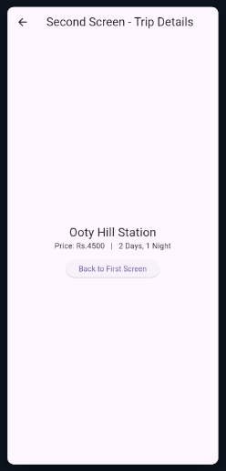

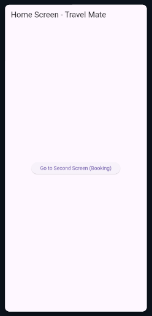

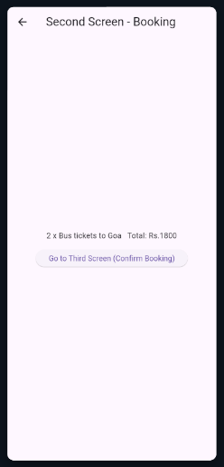

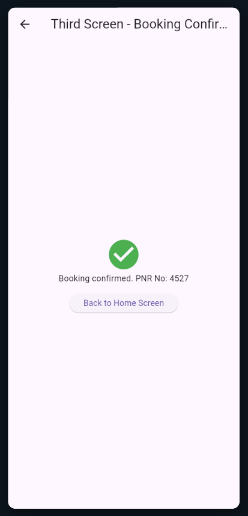

**Source code:** [exp04a_navigation.dart](travel_mate/lib/experiments/exp04a_navigation.dart) · [exp04b_named_routes.dart](travel_mate/lib/experiments/exp04b_named_routes.dart)

---

## Experiment 5 — State Management

**Aim:** Understand how Flutter manages changing data inside widgets and shares state across an application.

**Explanation:** The local-state example demonstrates setState() to update a widget when data changes. The Provider example introduces shared state management using Provider and ChangeNotifier, allowing listening widgets to rebuild when notified of updates.

**Output screenshots**

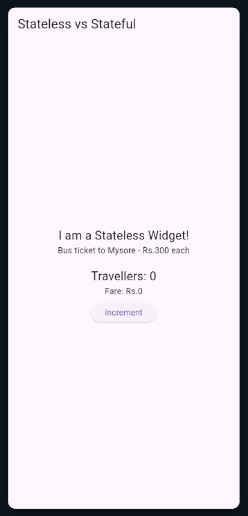


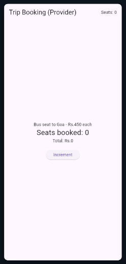

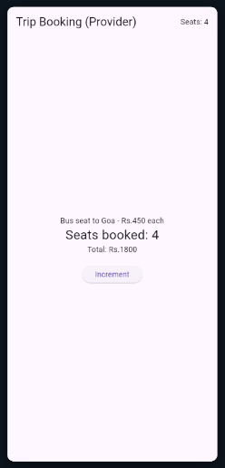

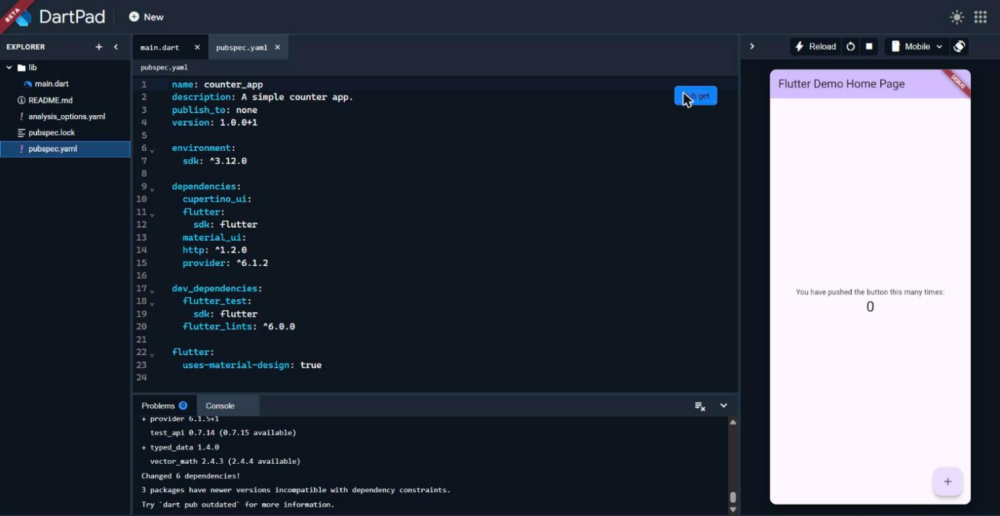

**Source code:** [exp05a_stateless_stateful.dart](travel_mate/lib/experiments/exp05a_stateless_stateful.dart) · [exp05b_provider.dart](travel_mate/lib/experiments/exp05b_provider.dart)

---

## Experiment 6 — Custom Widgets and Themes

**Aim:** Build reusable Flutter components and apply consistent styling across screens.

**Explanation:** The custom-widgets experiment demonstrates creating reusable UI elements instead of repeating the same widget code. The themes experiment shows how ThemeData can define a consistent visual style for an application.

**Output screenshots**

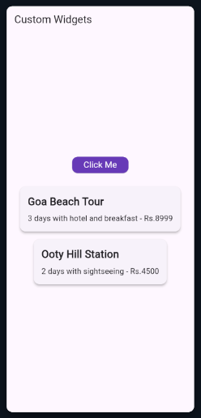

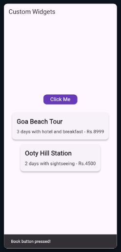

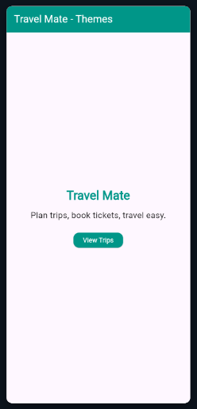

**Source code:** [exp06a_custom_widgets.dart](travel_mate/lib/experiments/exp06a_custom_widgets.dart) · [exp06b_themes.dart](travel_mate/lib/experiments/exp06b_themes.dart)

---

## Experiment 7 — Forms and Validation

**Aim:** Collect user input and validate form fields before accepting a submission.

**Explanation:** The form experiment demonstrates collecting traveller details through Flutter form widgets. The validation experiment uses form validators to check required fields and input formats, helping prevent invalid data from being submitted.

**Output screenshots**

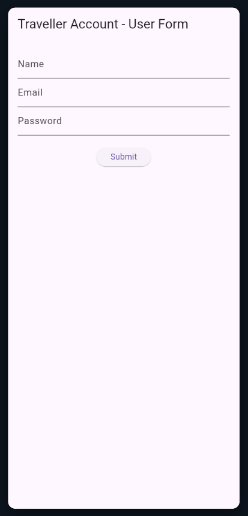

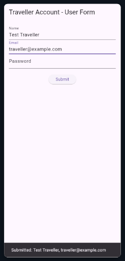

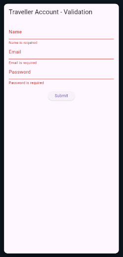

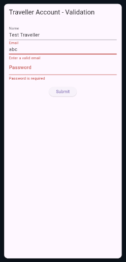

**Source code:** [exp07a_form.dart](travel_mate/lib/experiments/exp07a_form.dart) · [exp07b_form_validation.dart](travel_mate/lib/experiments/exp07b_form_validation.dart)

---

## Experiment 8 — Flutter Animations

**Aim:** Understand how to animate widgets and create smoother user interface transitions.

**Explanation:** The animations experiment demonstrates implicit animations using Flutter's animated widgets. The fade-and-slide experiment demonstrates transition effects that change a widget's opacity and position.

**Output screenshots**

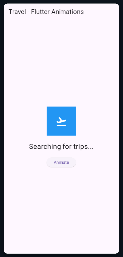

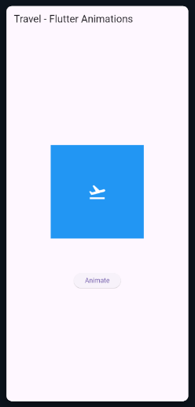

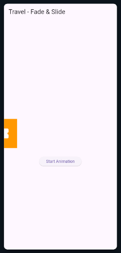

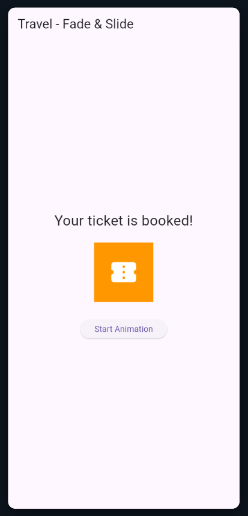

**Source code:** [exp08a_animations.dart](travel_mate/lib/experiments/exp08a_animations.dart) · [exp08b_fade_slide.dart](travel_mate/lib/experiments/exp08b_fade_slide.dart)

---

## Experiment 9 — REST API Integration

**Aim:** Retrieve data from an external REST API and display the results in a Flutter application.

**Explanation:** The API experiments demonstrate making HTTP requests, handling API responses, decoding JSON data, and displaying the returned information in the UI. They also illustrate loading or error states when a network request does not succeed.

**Output screenshots**

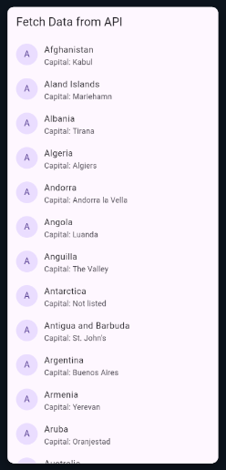

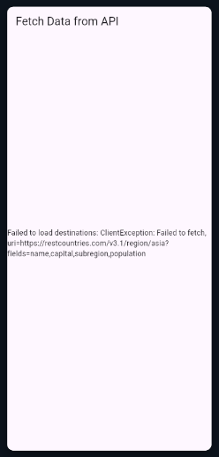

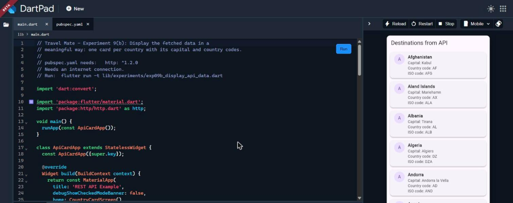

**Source code:** [exp09a_fetch_api.dart](travel_mate/lib/experiments/exp09a_fetch_api.dart) · [exp09b_display_api_data.dart](travel_mate/lib/experiments/exp09b_display_api_data.dart)

---

## Experiment 10 — Counter App, Testing and Debugging

**Aim:** Build a counter application, verify its behaviour with tests, and understand debugging and null-safety concepts.

**Explanation:** The counter experiment demonstrates updating displayed values through user interaction. The test demonstrates how Flutter tests can verify expected widget behaviour. The debugging experiment explores identifying and correcting common errors, including issues related to null safety.

**Output screenshots**


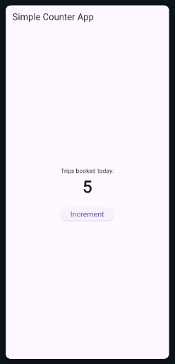

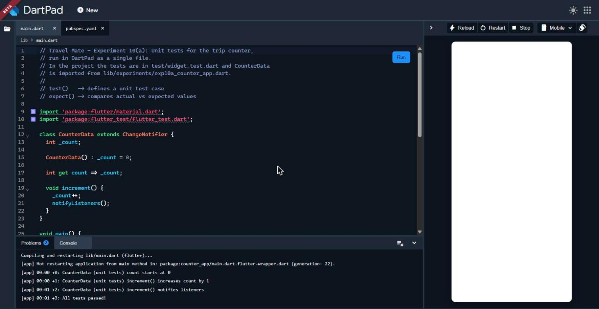

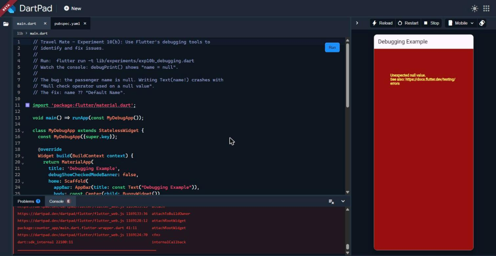

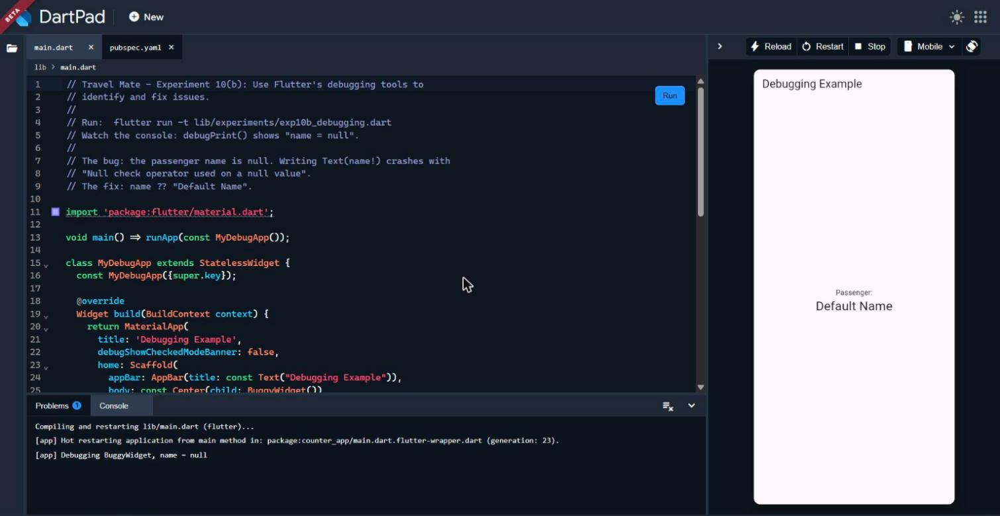

**Source code:** [exp10a_counter_app.dart](travel_mate/lib/experiments/exp10a_counter_app.dart) · [exp10b_debugging.dart](travel_mate/lib/experiments/exp10b_debugging.dart) · [widget_test.dart](travel_mate/test/widget_test.dart)

---

## How to Run the Project

### Prerequisites

- Flutter SDK
- Dart SDK (included with Flutter)
- Android Studio, VS Code, or another Flutter-compatible IDE
- An emulator, physical device, or Chrome for web

Check your Flutter installation:

```bash
flutter --version
flutter doctor
```

### Clone and install dependencies

```bash
git clone https://github.com/kundulayashwanth-dev/travel-mate.git
cd travel-mate/travel_mate
flutter pub get
```

### Run the application

```bash
flutter run
```

To run in Chrome:

```bash
flutter run -d chrome
```

### Run tests

```bash
flutter test
```

### Run an individual experiment

For example:

```bash
flutter run -t travel_mate/lib/experiments/exp02a_widgets.dart
```

Replace the file path with the experiment you want to run.

---

## Technologies Used

- **Flutter** — cross-platform UI toolkit
- **Dart** — programming language
- **Provider** — state management
- **http** — HTTP requests and REST API integration
- **flutter_test** — widget and unit testing

---

## Repository Structure

```text
travel-mate/
├── lib/
│   ├── main.dart
│   └── experiments/
│       ├── exp01b_dart_program.dart
│       ├── exp02a_widgets.dart
│       ├── exp02b_layouts.dart
│       ├── exp03a_responsive_ui.dart
│       ├── exp03b_breakpoints.dart
│       ├── exp04a_navigation.dart
│       ├── exp04b_named_routes.dart
│       ├── exp05a_stateless_stateful.dart
│       ├── exp05b_provider.dart
│       ├── exp06a_custom_widgets.dart
│       ├── exp06b_themes.dart
│       ├── exp07a_form.dart
│       ├── exp07b_form_validation.dart
│       ├── exp08a_animations.dart
│       ├── exp08b_fade_slide.dart
│       ├── exp09a_fetch_api.dart
│       ├── exp09b_display_api_data.dart
│       ├── exp10a_counter_app.dart
│       └── exp10b_debugging.dart
├── screenshots/
├── test/
│   └── widget_test.dart
├── pubspec.yaml
└── README.md
```

---

## License

No license file was supplied with this project. Add a LICENSE file if you intend to distribute it under an open-source license.
