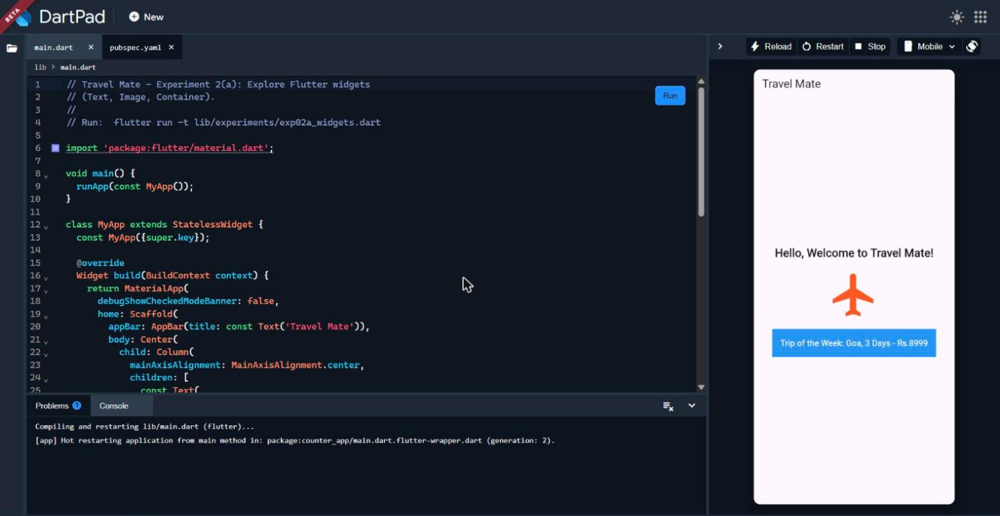
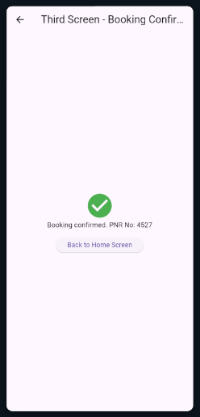
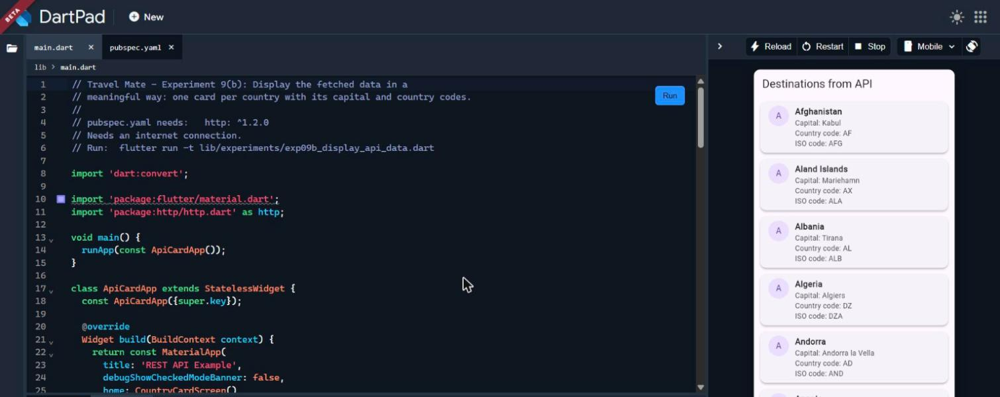

# Travel Mate - Flutter Mini Project (Experiments 1 to 10)

A travel-planning themed Flutter project built experiment-wise. Every
experiment is a complete, separate program in `lib/experiments/`.
`lib/main.dart` is a launcher that lists them all.

## Run on your computer

```
flutter create --project-name travel_mate .
flutter pub get
flutter run -d chrome        (or a phone / emulator)
flutter test                 (Experiment 10a)
```

`flutter create .` adds the android/web/windows folders and keeps the code
that is already here.

One experiment by itself:
`flutter run -t lib/experiments/exp02a_widgets.dart`

## Run on DartPad (how the report screenshots were taken)

1. Open https://dartpad.dev and paste one experiment file into `main.dart`.
2. For 5b, 9a and 9b, add `provider: ^6.1.2` and `http: ^1.2.0` under
   `dependencies:` in DartPad's `pubspec.yaml` and press **Pub get**.
3. Press **Run**.

## Experiments

| Exp | File | What it shows |
|-----|------|---------------|
| 1b | exp01b_dart_program.dart | Dart program: greeting and trip cost |
| 2a | exp02a_widgets.dart | Text, Image, Container |
| 2b | exp02b_layouts.dart | Row, Column, Stack |
| 3a | exp03a_responsive_ui.dart | MediaQuery: mobile / tablet / desktop |
| 3b | exp03b_breakpoints.dart | LayoutBuilder breakpoints |
| 4a | exp04a_navigation.dart | Navigator.push / pop |
| 4b | exp04b_named_routes.dart | Named routes: Home, Booking, Confirmed |
| 5a | exp05a_stateless_stateful.dart | Stateless vs Stateful, setState |
| 5b | exp05b_provider.dart | Booked seats with Provider |
| 6a | exp06a_custom_widgets.dart | CustomButton and CustomCard |
| 6b | exp06b_themes.dart | ThemeData and custom styles |
| 7a | exp07a_form.dart | Form with Name, Email, Password |
| 7b | exp07b_form_validation.dart | Validation and error messages |
| 8a | exp08a_animations.dart | AnimatedContainer, AnimatedOpacity |
| 8b | exp08b_fade_slide.dart | FadeTransition, SlideTransition |
| 9a | exp09a_fetch_api.dart | Fetch countries from the CountriesNow API |
| 9b | exp09b_display_api_data.dart | Country cards from the API data |
| 10a | exp10a_counter_app.dart + test/widget_test.dart | Unit and widget tests |
| 10b | exp10b_debugging.dart | debugPrint and null-safety fix |

## Notes

- 9a and 9b need internet. For an Android release build add
  `<uses-permission android:name="android.permission.INTERNET"/>` to
  `android/app/src/main/AndroidManifest.xml`.
- 10b: change `name ?? "Default Name"` to `name!` to see the crash. On the
  web the red screen says "Unexpected null value"; on Android it says
  "Null check operator used on a null value".
- On the newest Flutter beta, `package:flutter/material.dart` shows a
  deprecation notice (use `package:material_ui/material_ui.dart`). The
  programs still run.

## Screenshots

The `screenshots/` folder has the outputs captured while each experiment
was running on DartPad (Flutter 3.50.0, Dart 3.14.0). File names start with
the experiment number, for example `exp05b_after.png`.

| Welcome (2a) | Booking confirmed (4b) | Country cards (9b) |
|---|---|---|
|  |  |  |
